# Capturas de los datasets originales y de los resultados de los algoritmos

Ni los videos de prueba (`datasets vision velocimetria/`: 202 videos, 17 GB de video dentro de 45 GB de
datos) ni los videos de resultados van al repositorio. En su lugar, esta carpeta guarda **una imagen de
cada uno**, en JPEG reducido (25 MB en total). Las imagenes se reparten en dos mitades:

1. **Datasets originales** (`videos/`, `hojas_contacto/`, `indice_videos.csv`): un fotograma de cada
   video tal como viene en el dataset, sin procesar.
2. **Resultados de los algoritmos** (`resultados/<caso>/`): cada carpeta junta **la entrada y la
   salida** del algoritmo. `entrada_*.jpg` es el fotograma del video original que entra al algoritmo.
   El resto son las figuras que genera el caso y dos fotogramas de cada video de resultado.

| Carpeta / archivo | Que hay |
|---|---|
| `hojas_contacto/` | Un mosaico por dataset con la miniatura y el nombre de cada video. Es lo mas rapido para ver que hay |
| `videos/` | Un fotograma de cada video del dataset (el de la mitad de su duracion), con 640 px de lado mayor. Sigue la misma estructura de carpetas que el dataset |
| `indice_videos.csv` | Por video: ruta, resolucion, fps, fotogramas, duracion, tamano y que fotograma se capturo |
| `resultados/<caso>/entrada_*.jpg` | El video original del caso, a 1280 px. Incluye los videos que no estan en el dataset (Ngwerere, SMC, el canal de WhatsApp y las grabaciones de los directos), que no tienen otra captura |
| `resultados/<caso>/fig*.jpg`, `sti_*.jpg`... | Las figuras del caso, copiadas de su `salidas/` (los PNG originales siguen alli) |
| `resultados/<caso>/<video>_25pct.jpg`, `_75pct.jpg` | Dos fotogramas de cada video de resultado, al 25 % y al 75 % de su duracion, para que se vea que la medida cambia con el tiempo |
| `resultados/validacion_directo/` | Una medida del programa en directo sobre cada video con referencia, mas su salida de texto |
| `generar_capturas.py` | El script que lo rehace todo |

Dos avisos para leer las imagenes:

- **Algunas capturas tienen el contraste estirado**: las que tienen la mediana de brillo por debajo de
  20/255, porque sin estirar serian un rectangulo negro. En `videos/` son 18 (columna
  `contraste_estirado` del indice); en `resultados/` llevan `_estirado` en el nombre. Son el Bradano
  (agua a 0.12/255), las GoPro del Brenta, el Noce, el Basento y tres videos de Boneyard grabados de
  madrugada o al anochecer. Lo que se ve no es el aspecto real del video.
- Las camaras Reolink de Heiskanen estan montadas de lado. En `videos/` salen giradas como indican sus
  metadatos (en vertical); en `resultados/validacion_directo/` salen en la orientacion nativa, que es
  la de su modelo de camara y la que usa el programa para medir.

## 1. Los datasets originales

| Dataset | Videos | Tamano | Duracion | Hoja de contacto |
|---|---|---|---|---|
| USGS Boneyard Creek (camara IP fija, 2017-2018) | 61 | 2.5 GB | 37 min | [Boneyard_Creek.jpg](hojas_contacto/Boneyard_Creek.jpg) |
| Heiskanen et al., Oulankajoki (RGB + termica, 2023-2024) | 48 | 1.8 GB | 24 min | [Heiskanen_Oulankajoki_River.jpg](hojas_contacto/Heiskanen_Oulankajoki_River.jpg) |
| Heiskanen et al., Vantaanjoki Pitkakoski (RGB + termica) | 46 | 2.1 GB | 23 min | [Heiskanen_Vantaanjoki_Pitkakoski.jpg](hojas_contacto/Heiskanen_Vantaanjoki_Pitkakoski.jpg) |
| HARMONIOUS (13 rios; Murg solo publica fotogramas) | 42 | 9.2 GB | 17 min | [HARMONIOUS.jpg](hojas_contacto/HARMONIOUS.jpg) |
| Otros: Hommerich (2), Field Videos (2), Basento (1) | 5 | 1.9 GB | 3 min | [Otros.jpg](hojas_contacto/Otros.jpg) |

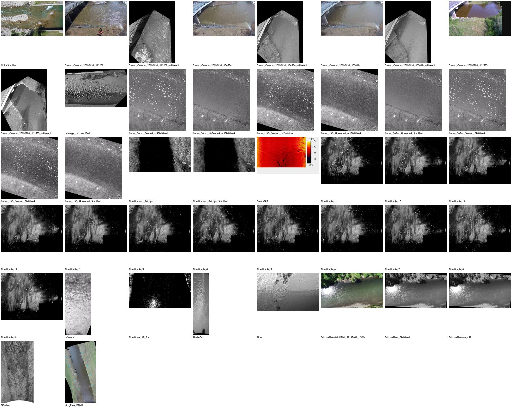

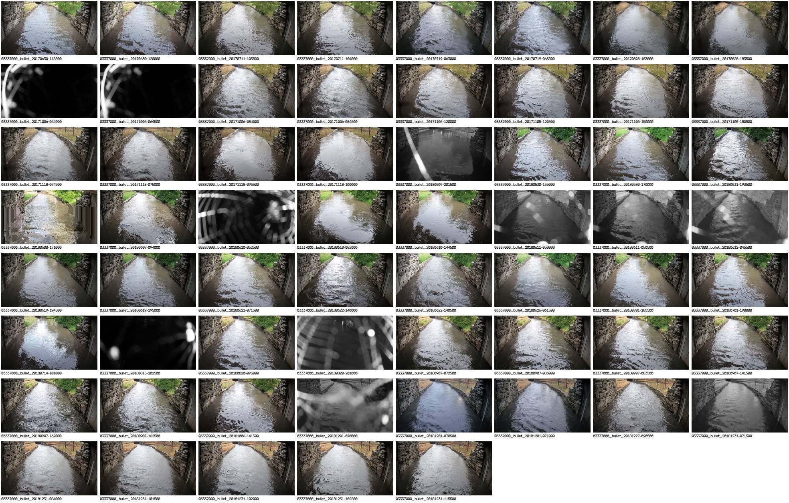

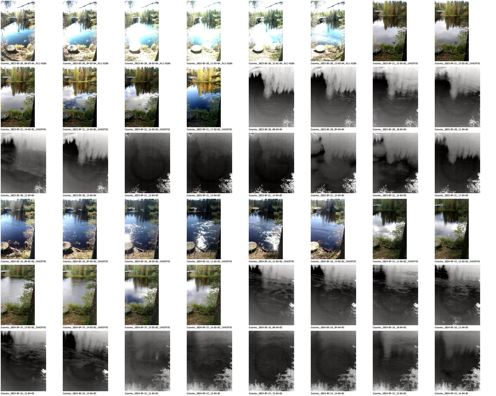

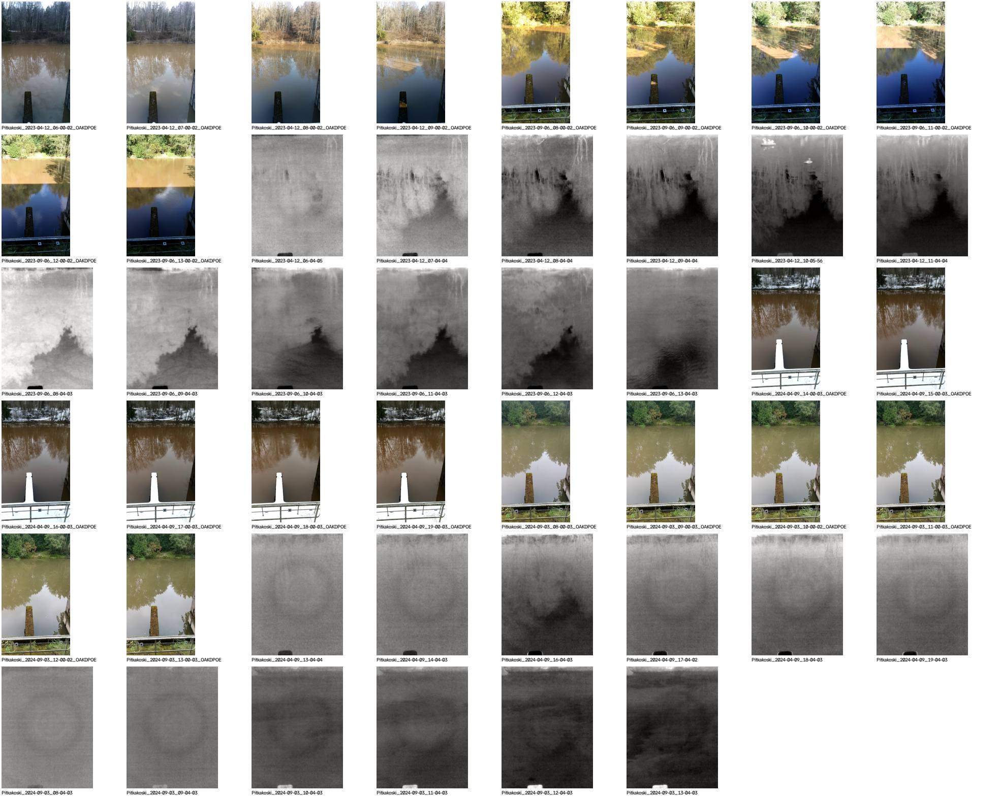

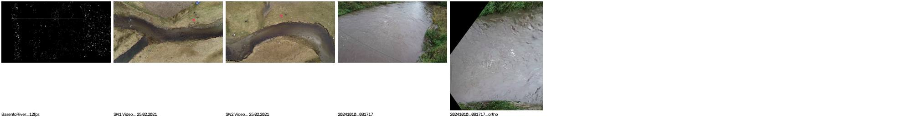

## 2. Los resultados de los algoritmos, caso por caso

Los casos completos (notebooks, figuras originales en PNG y videos) estan en `test_pyorc/analisis_*` y
en `analisis_kurome_directo_stiv/`.

| Caso (`resultados/...`) | Algoritmo | Entrada original | Resultado |
|---|---|---|---|
| [`ngwerere/`](resultados/ngwerere/) | LSPIV (pyorc) | [Ngwerere, camara fija oblicua](resultados/ngwerere/entrada_ngwerere.jpg) | Q 0.1672 m3/s frente a 0.164 del ejemplo publicado (+1.9 %) |
| [`smc_pyorc/`](resultados/smc_pyorc/) | LSPIV (pyorc) | [Sile Main Canal, dron cenital](resultados/smc_pyorc/entrada_SMC_D_RC_022.jpg) | Q 1.4565 m3/s frente a 1.4362 del aforo ADV (+1.4 %) |
| [`smc_stiv/`](resultados/smc_stiv/) | STIV desde cero (OpenCV) | [el mismo video](resultados/smc_stiv/entrada_SMC_D_RC_022.jpg) | Q 1.4475 m3/s frente a 1.4362 del aforo ADV (+0.8 %) |
| [`boneyard/`](resultados/boneyard/) | STIV, camara oblicua sin geometria | [Boneyard Creek, 2018-06-10](resultados/boneyard/entrada_20180610-082000.jpg) | 0.2427 alturas de camara/s, 16 de 21 estaciones; sin caudal (no hay seccion) |
| [`bradano/`](resultados/bradano/) | STIV sobre video ortorrectificado | [Rio Bradano (estirado)](resultados/bradano/entrada_RiverBradano_estirado.jpg) | 5 de 7 verticales, sesgo -3.1 %, RMSE 0.068 m/s |
| [`arrow/`](resultados/arrow/) | STIV, experimento de sembrado | [sin sembrar](resultados/arrow/entrada_sin_sembrar.jpg) / [sembrado](resultados/arrow/entrada_sembrado.jpg) | sin sembrar: 0 de 49 estaciones (el resultado buscado); sembrado: 0.389 m/s, -6.7 % en la media |
| [`hommerich/`](resultados/hommerich/) | STIV metrico, camara oblicua calibrada | [Geul en Hommerich](resultados/hommerich/entrada_20241010_081717.jpg) | v superficial 0.943 m/s, Q 13.68 m3/s (sin referencia que lo valide) |
| [`canal_riego/`](resultados/canal_riego/) | STIV, video de WhatsApp sin datos de campo | [canal de riego](resultados/canal_riego/entrada_whatsapp.jpg) | 0.0590 alturas de camara/s, 6 de 15 estaciones; PTV arbitro r +0.984 |
| [`canal_lejano/`](resultados/canal_lejano/) | STIV, experimento de alcance | el mismo video | el campo lejano no es medible: aliasing a coherencia 0.98 |
| [`canal_filtro_adaptado/`](resultados/canal_filtro_adaptado/) | filtro adaptado (track-before-detect) | el mismo video | nada mas alla de Y = 3.20; lo que borra el trazador es la resolucion |
| [`canal_completo/`](resultados/canal_completo/) | STIV + modelo Shiono-Knight | el mismo video | **simulacion**: 0.0476 en todo el ancho frente a 0.0534 en el tercio medido |
| [`canal_stiv_puro/`](resultados/canal_stiv_puro/) | STIV, solo lo medido | el mismo video | flechas y STI de las 6 estaciones medidas; huecos donde no se mide |
| [`canal_seccion_completa/`](resultados/canal_seccion_completa/) | STIV + estaciones deducidas | el mismo video | 15 flechas: **6 medidas y 9 deducidas del modelo**, dibujadas igual (ver su README) |
| [`directo/`](resultados/directo/) | STIV en tiempo real (`stiv_directo.py`) | grabaciones de [Myoshoji](resultados/directo/entrada_myoshoji.jpg), [Kurome](resultados/directo/entrada_kurome.jpg) y [Shimoda](resultados/directo/entrada_shimoda.jpg) | Myoshoji de dia, 0.483 m/s de mediana, coherente con el aforo oficial; las graficas y los diagnosticos de la verificacion de nivel estan en la misma carpeta |

### Entrada y salida, lado a lado

| Entrada original | Resultado del algoritmo |
|---|---|
| 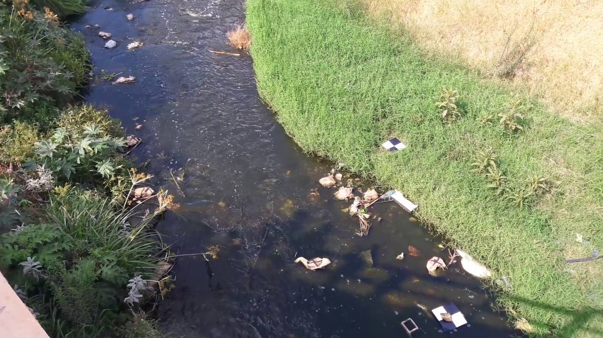 | 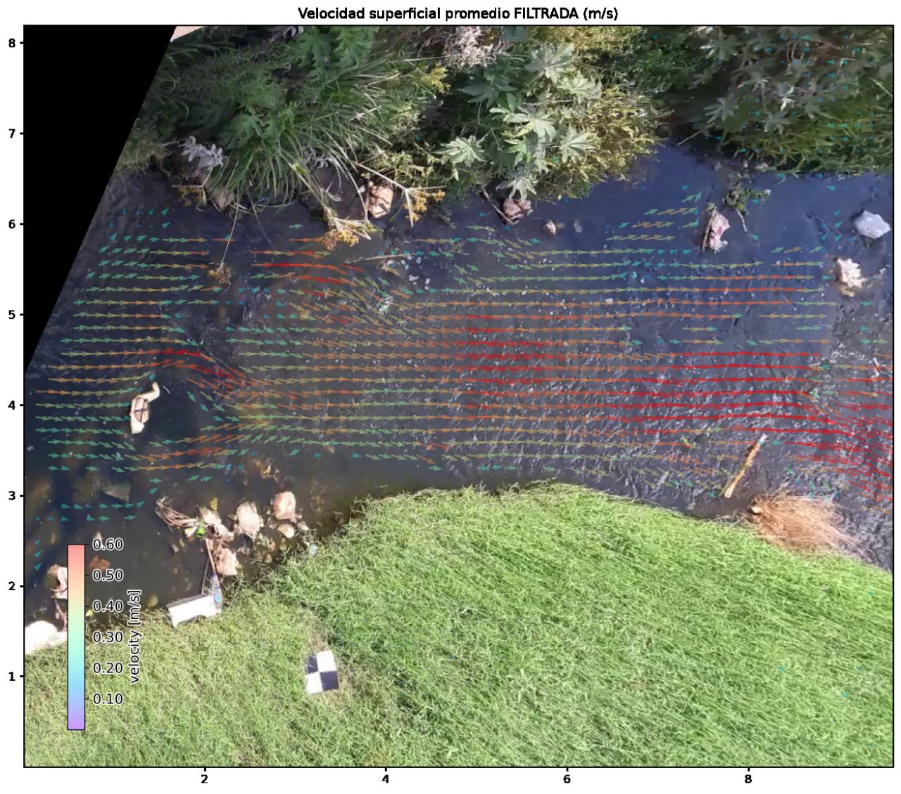 |
| 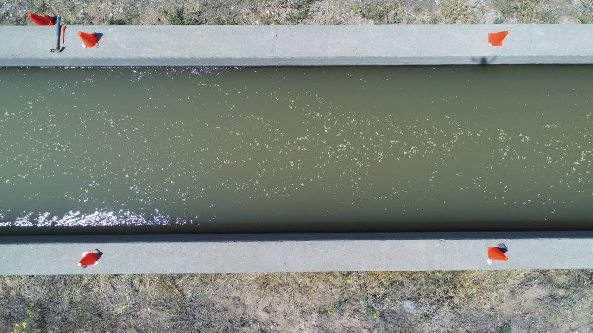 | 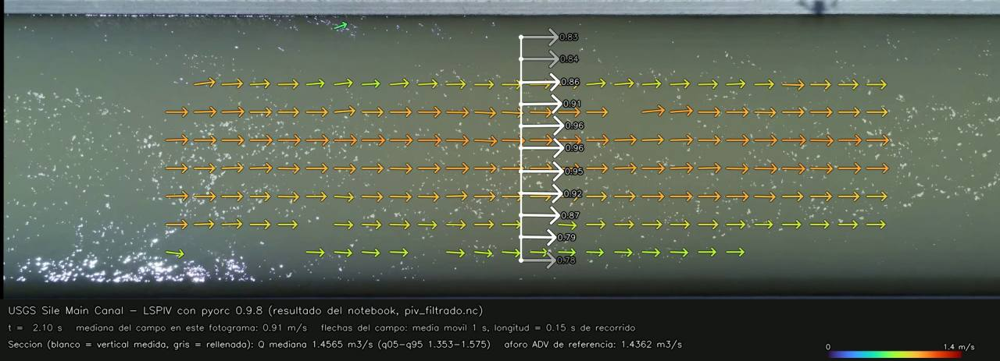 |
|  | 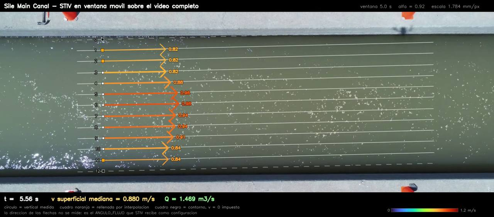 |
| 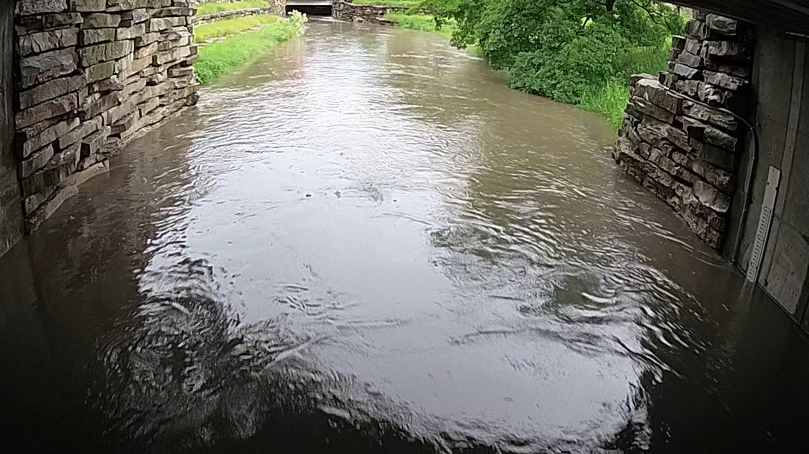 | 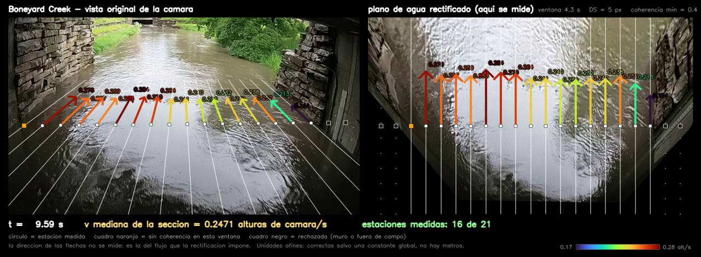 |
| 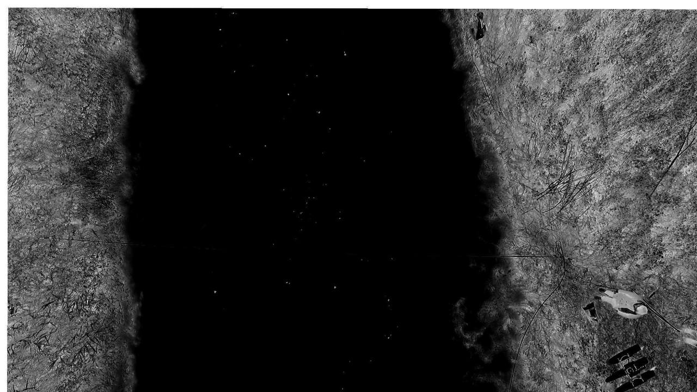 | 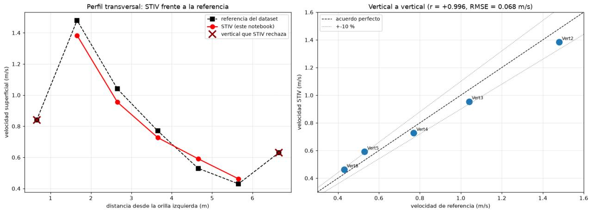 |
| 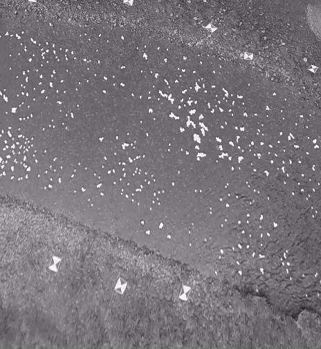 |  |
| 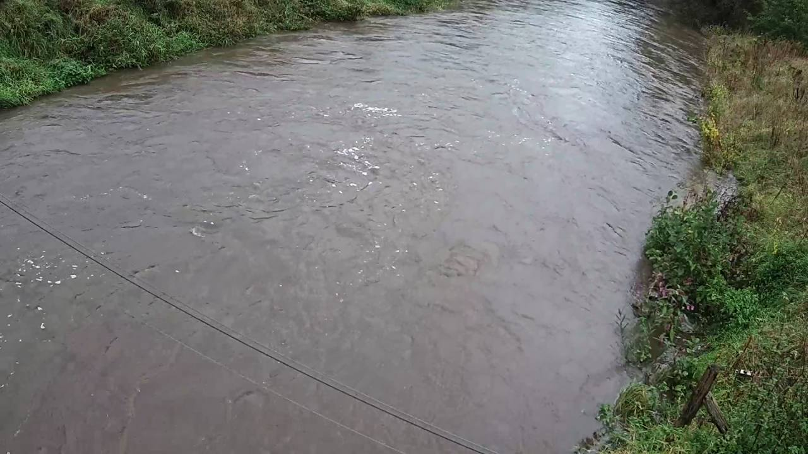 | 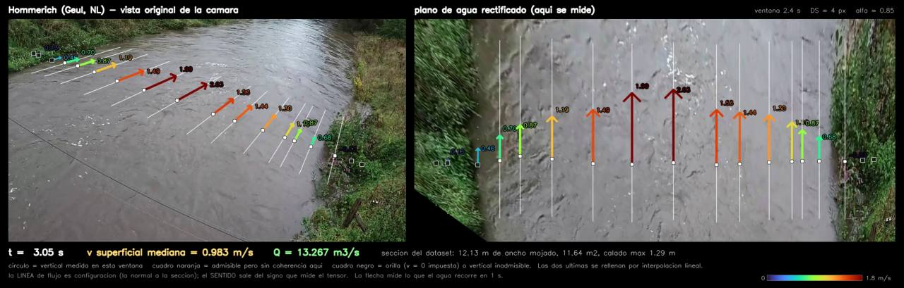 |
| 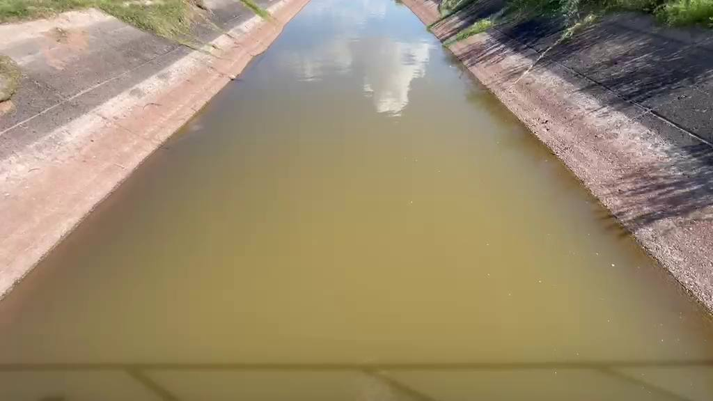 | 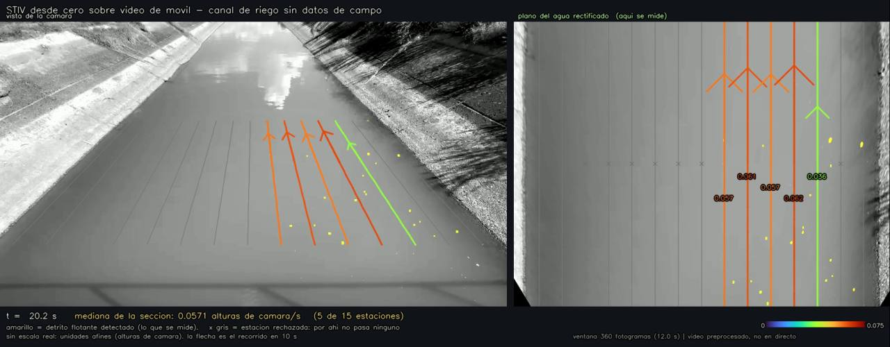 |
| 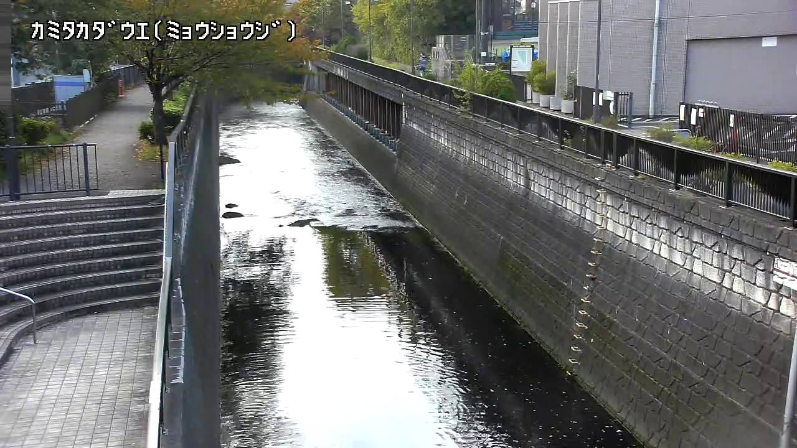 | 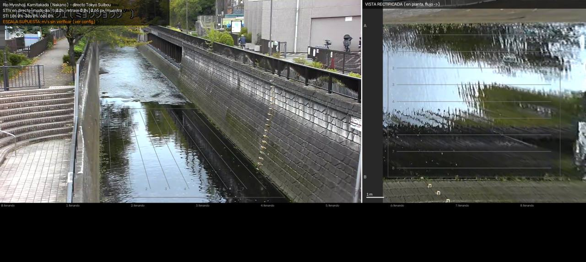 |

### Programa en directo contra referencias (`resultados/validacion_directo/`)

Aqui `stiv_directo.py` se pasa por videos que tienen una medida independiente, con el mismo codigo que
corre en directo. Cada imagen es **la medida del medio del video** (ni la mejor ni la peor) y la dibuja
el propio programa: video con flechas, vista rectificada y el STI de cada estacion con su pendiente.
Los videos de entrada estan en `videos/` (Sile en `resultados/smc_*/`). Las cifras de la tabla
corresponden al video entero (mediana de todas sus medidas) y estan en el `.txt` de cada caso.

| Caso | Referencia | Resultado |
|---|---|---|
| [USGS Sile Main Canal](resultados/validacion_directo/sile.jpg) (dron, sin estabilizar) | aforo ADV | 11/11 verticales, **Q 1.4537 vs 1.4362 m3/s (+1.2 %)** |
| [Rio Bradano](resultados/validacion_directo/bradano.jpg) (HARMONIOUS) | 7 verticales | 5/7, sesgo -4.5 %, RMSE 0.070 m/s, r +0.992 |
| [Oulankajoki 08:03](resultados/validacion_directo/heiskanen_08-03-04.jpg) y [09:03](resultados/validacion_directo/heiskanen_09-03-04.jpg) | ADCP | 7-8 de 20 estaciones (el tercio cercano), **-14 a -18 %**, sin explicar |
| Oulankajoki [10:03](resultados/validacion_directo/heiskanen_10-03-04.jpg), [11:03](resultados/validacion_directo/heiskanen_11-03-04.jpg), [12:01](resultados/validacion_directo/heiskanen_12-01-04.jpg) | ADCP | 1-3 de 20: sol de cara, agua saturada, el programa se abstiene |
| [Oulankajoki 13:03](resultados/validacion_directo/heiskanen_13-03-04.jpg) | ADCP | 15 de 20 a **+35 %**: acepta los destellos del sol con coherencia alta. Es el caso peligroso |

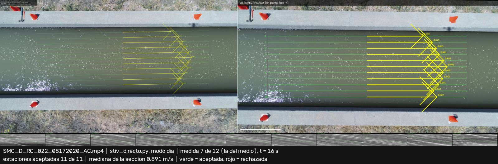

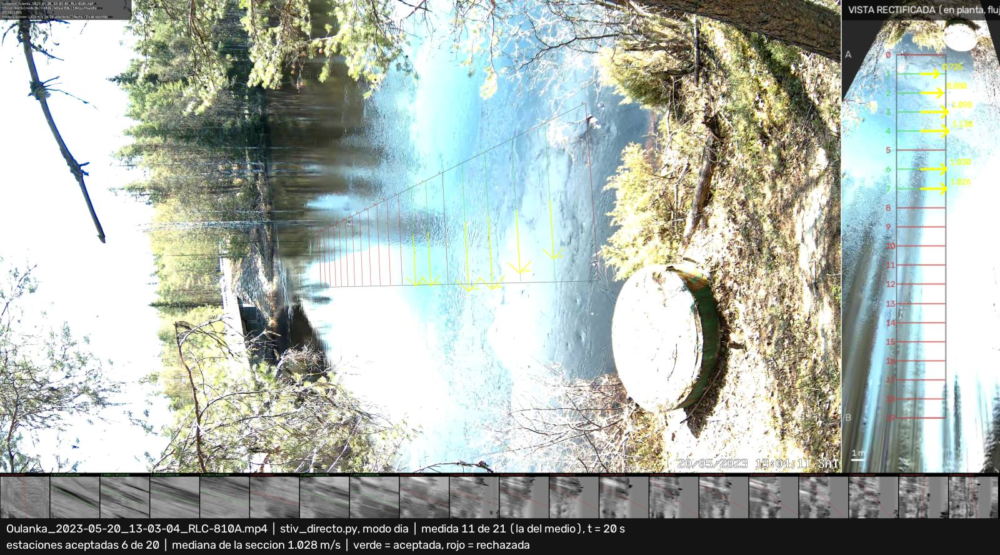

## Como se rehace

Desde esta carpeta, con el `.venv` del programa en directo (solo numpy y OpenCV):

```powershell
..\analisis_kurome_directo_stiv\.venv\Scripts\python.exe generar_capturas.py videos       # ~10 min, lee los 202 videos
..\analisis_kurome_directo_stiv\.venv\Scripts\python.exe generar_capturas.py resultados   # ~2 min, entrada + salidas de los 14 casos
..\analisis_kurome_directo_stiv\.venv\Scripts\python.exe generar_capturas.py validacion   # ~5 min
```

`resultados` lee las entradas de sitios que no estan en el repositorio: el dataset en
`datasets vision velocimetria/`, el video del canal en `videos/` y las grabaciones FFV1 en
`analisis_kurome_directo_stiv/validacion/grabaciones/`. La lista de casos esta en `CASOS`, dentro del
script; para anadir un caso basta con anadir una entrada a esa lista.

`validacion` vuelve a correr `validacion/caso_sile.py`, `caso_bradano.py` y `caso_heiskanen.py` sin
modificarlos: solo intercepta cada medida para quedarse con su fotograma. Cuando se genero, el
2026-10-14, sus salidas de texto coincidieron linea a linea con las guardadas en `validacion/salidas/`
(salvo el tiempo de ejecucion). Necesita el dataset en `datasets vision velocimetria/` y el video del
Sile en `test_pyorc/USGS/Video/`. Los avisos `[h264] error while decoding MB` que salen al leer Boneyard
se deben a fotogramas corruptos del propio dataset y no afectan.
